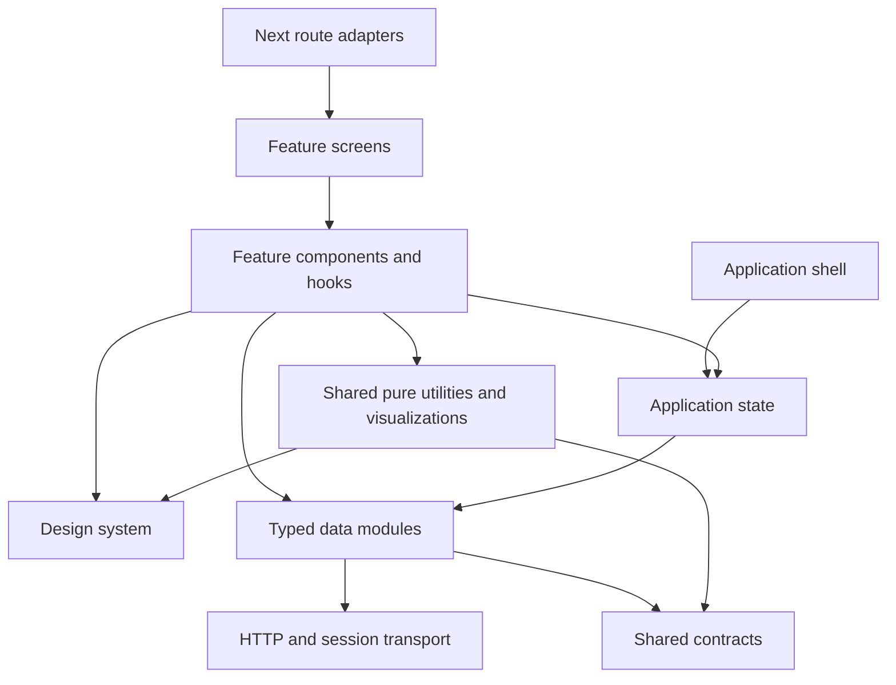

# Maintainex architecture

This is the current implementation contract. Read root `AGENTS.md` first. The earlier `Project.md` and research documents contain historical requirements; they do not override current product decisions.

## Dependency direction



Cross-feature UI integration goes through the target feature's `index.ts`. A feature must not reach another feature's private components or hooks, including through relative paths or dynamic imports. Cycles are rejected. The design system cannot import application state, data, features or shell code. Data modules cannot import UI/state. Shared utilities cannot import feature behavior. Contracts cannot import implementations.

## Repository map

```text
client/
  app/                    # Next routes: re-export one owning screen
  features/<domain>/
    screens/              # Route-level orchestration
    components/           # Domain-specific UI
    hooks/                # Domain behavior where a hook earns its own unit
    index.ts              # Explicit public integration exports, when needed
  design-system/
    tokens.css            # Sole runtime palette and foundation values
    components.css        # Shared primitive presentation
    primitives/           # Small reusable controls and structures
    patterns/             # Existing public adapters and composed patterns
    contracts.json        # Human-owned variants, states, revisions, descriptions
    inventory.json        # Generated component + route inventory
    index.ts              # Public primitive exports
  shell/                  # Navigation, sidebar, topbar, session-aware composition
  state/                  # Authentication and activity providers
  data/
    http.ts               # One authenticated HTTP transport
    session.ts            # Session-token storage/access
    realtime.ts           # Socket transport
    api/<domain>.ts       # Typed endpoint functions
  shared/                 # Pure utilities, charts and calendar visualizations
  types/                  # Existing API/domain contracts
  architecture/routes.json # Migration record; inventory.json has current route coverage
  scripts/                # Dependency, token and inventory checks
server/
  src/modules/<domain>/   # Existing backend feature modules
  src/config/             # Runtime dependencies/configuration
  src/middlewares/        # Authentication, error handling and request boundaries
  prisma/                 # Schema and migrations
  tests/                  # Existing backend service/HTTP regression tests
```

A directory is an ownership boundary, not a requirement to create empty repositories, services, hooks or interfaces for every function. Extract a responsibility when it has independent behavior, reuse or a meaningful presentation contract. Do not create abstraction layers merely to rename calls.

## Extension seams

| Change | Extension point | Avoid |
| --- | --- | --- |
| New feature/page | New feature screen/components and a one-line route adapter | Business logic in `app/page.tsx` |
| New action variant | Button variant, semantic CSS, contract and inventory update | Per-page button color/shape implementations |
| New status | Owning feature's badge mapping using shared Badge | Arbitrary palette or undocumented semantics |
| New API operation | Owning typed `data/api/<domain>.ts` module | Fetch in a view or adding to the compatibility API barrel |
| New navigation item | `shell/navigation.ts` | Duplicating navigation maps or restoring withdrawn routes |
| New table | Typed columns passed to DataTable | Copying its base table styling |
| New/create vs edit form | Shared entity form with initial values/mode | Duplicated form implementations |
| New aggregate | Server-side aggregation with explicit query scope | Labeling a paginated subset as a workspace total |
| New backend capability | Existing module router/controller/service/repository conventions | Controller data access, duplicated auth or remote calls in views |

Some changes legitimately alter a shared contract or integration registry. The goal is to keep changes local and intentional, not claim that arbitrary features can be added without touching any existing file. Preserve public exports and existing behavior unless the user authorizes a breaking change. Record significant boundary changes as an ADR.

## Server boundaries

The backend already uses modules. This frontend refactor does not rename working backend modules or change database/auth contracts. New server work must put HTTP validation/auth in routes/middleware, orchestration in services, and persistence in repositories where applicable. Existing services still contain direct Prisma access; consolidating those is a separate migration, not something this change claims to have completed. Keep ownership/privacy checks server-side and preserve transaction/idempotency behavior. Database migrations require explicit scope, environment identification and a rollback/recovery plan; do not apply one as an incidental UI refactor.

## Current migration status and explicit debt

- All 49 page entries are thin adapters, including retained routes, withdrawn implementations and the new design inventory page.
- Existing domain components now live under their owning features. The shell and organization/feed sections have been split into smaller units.
- Shared actions, fields, badges, headers, metrics, tables and states have reusable implementations. Existing compatibility adapters under `design-system/patterns` preserve call sites.
- The source inventory covers existing feature components, screens and adapters. Entries marked `visual review pending` are not falsely presented as fully redesigned or accessibility-certified.
- Some feature layouts still contain native controls and semantic Tailwind styling. Redesign them by composing shared primitives when touching them; the task does not claim pixel parity with every generated board.
- New source modules have a 350-line ceiling. The withdrawn historical Reports screen has a fixed 490-line quarantine ceiling; it is not exposed in navigation and must not grow. Extract it before future activation. No generic exception mechanism is provided.
- `lib/api.ts` remains a compatibility export for historical consumers, but imports from it are rejected in checked source. New operations live in the owning data module.
- Public-first entry is an approved requirement. Detailed public/private routing remains deferred. Existing account gating is preserved for the current workspace; only `/design-system` is a new account-free, backend-independent component reference.
- Withdrawn reports, leaderboards, repository discovery, quests, recommendations and saved opportunities stay withdrawn.

## Validation and enforcement

From repository root:

```sh
npm run check
npm run build
npm run build --workspace maintainex-server
npm run test --workspace maintainex-server
```

For design edits:

```sh
npm run inventory:update --workspace maintainex-client
npm run check --workspace maintainex-client
```

`npm run check` runs dependency/token/inventory checks, negative architecture tests and TypeScript. Client builds run architecture checks first. The CI workflow runs client checks/build and backend build/tests. The inventory is checked for staleness using source hashes and current import/route coverage; it is not an optional document.

Checks inspect static and literal dynamic imports, resolve aliases and relative imports, reject computed module loading, detect cycles and reject raw visual colors outside tokens. They are engineering guardrails, not a security sandbox that can stop a person from editing checks or skipping CI. Remote required checks and branch protection must be configured by repository administrators; this task does not claim to have changed hosting settings.

Visual acceptance still requires browser review: dark/light, narrow widths, long content, keyboard/focus, disabled/loading/error/empty states and relevant persistence. Test real contracts; do not add tests that merely restate JSX.

## Change process

1. Locate the owner and existing inventory entry.
2. Change the smallest owning component or data module. Reuse shared primitives.
3. Preserve exports or provide a migration adapter. Keep dependencies directed downward.
4. Update contract variants/states and revision for intentional design/API changes.
5. Regenerate inventory, review its source/consumer diff, and document the decision.
6. Run checks and targeted behavior tests; build and inspect affected pages.
7. Report changed behavior, validation and remaining limits accurately.

Architecture decisions: [ADR 0001](./adr-0001-modular-frontend.md). Design lifecycle: [design inventory guide](../design/inventory/README.md).

Implementation validation: [validation record](./validation.md).
