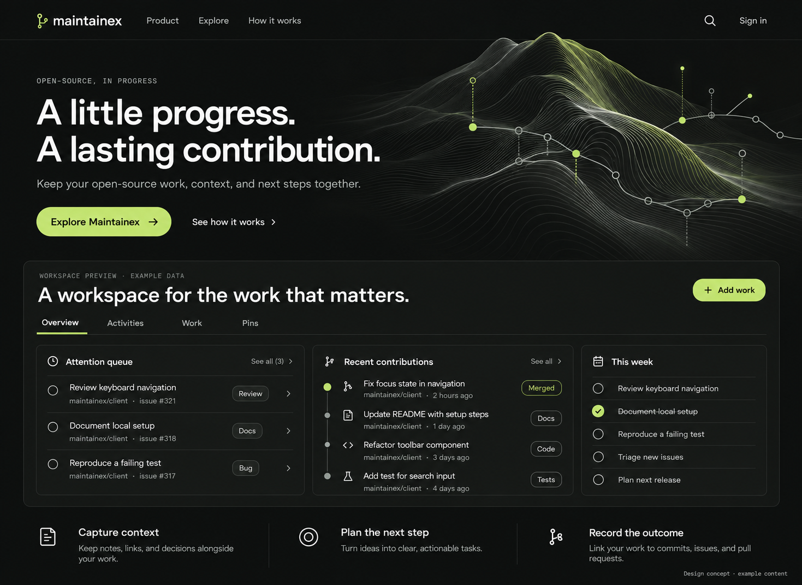
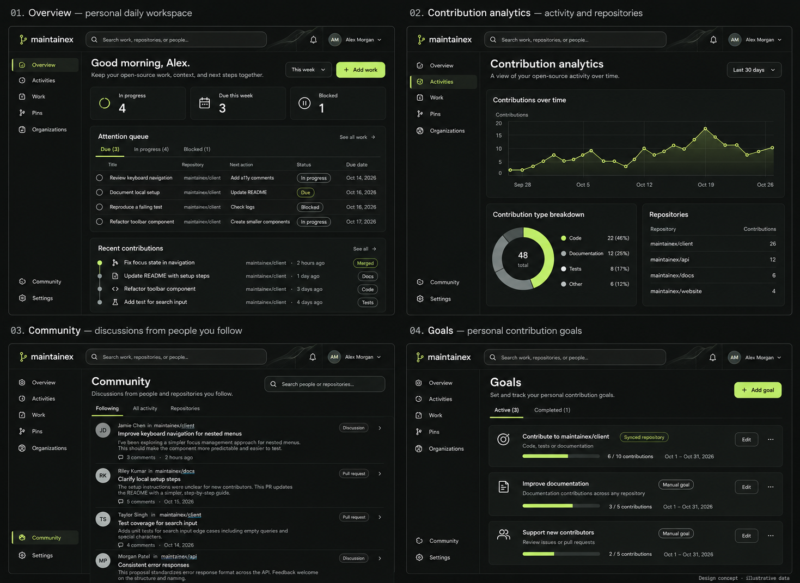
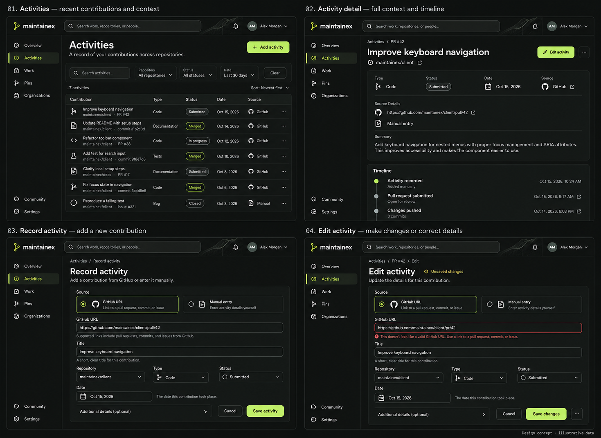
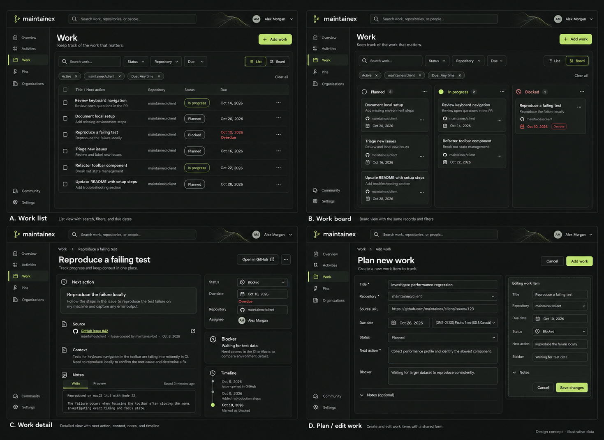
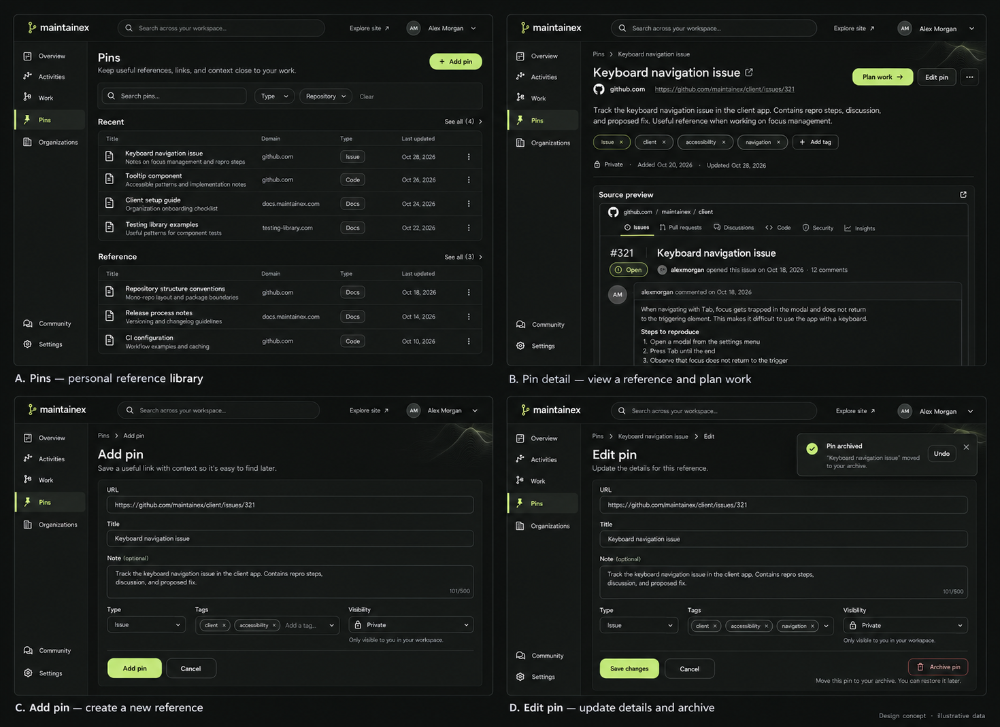
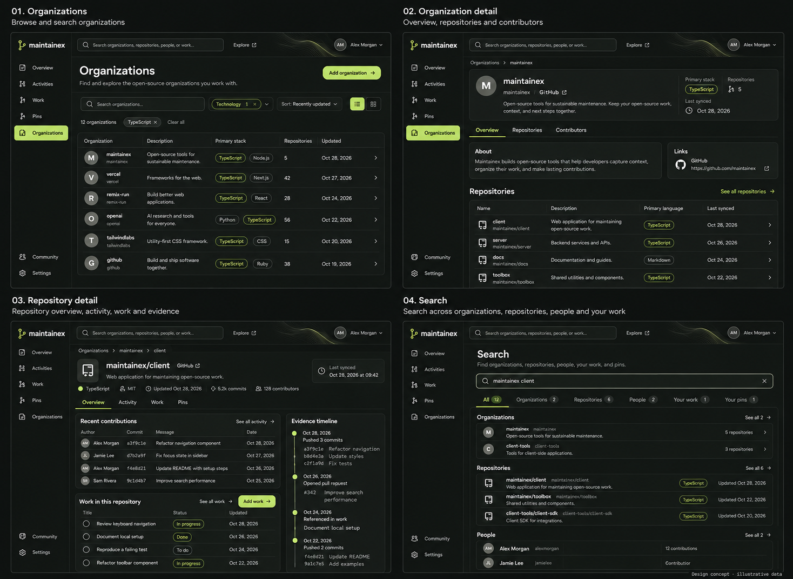
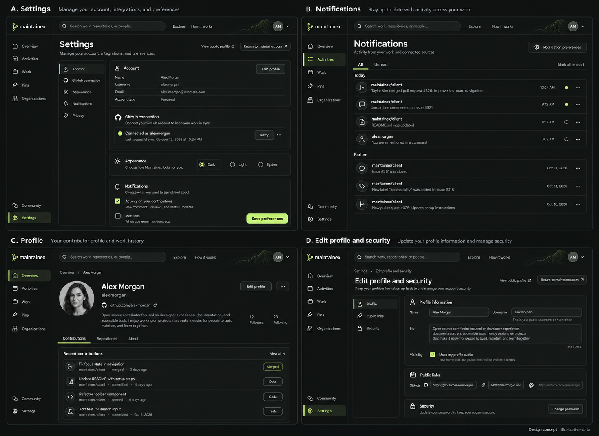
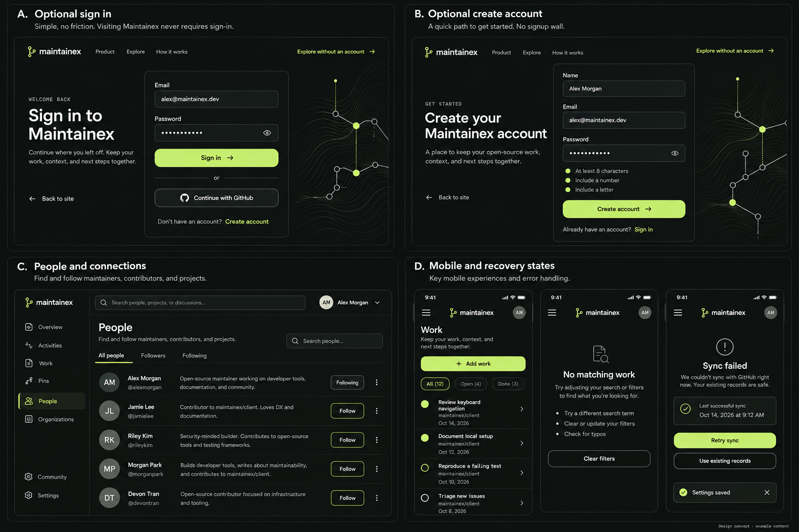

# Maintainex — charcoal and lime

Generated design concepts using example content. Public entry is account-free; authentication is an optional separate flow. The running application has not been redesigned by this image task.

## Public homepage

## Overview, analytics, community and goals

## Activities: list, detail, create and edit

## Work: list, board, detail and planning

## Pins: library, detail, create and edit

## Organizations, repositories and search

## Settings, notifications, profile and security

## Optional authentication, people and responsive states

Shared tokens and reuse rules: [design system](./README.md). Route mapping and completion status: [coverage](./coverage.md). Prompt set: [prompts](./prompts.json).
